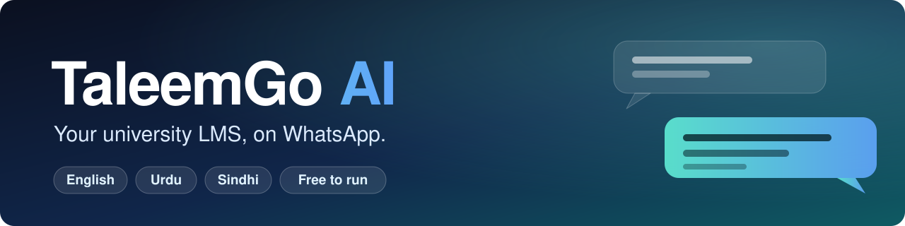
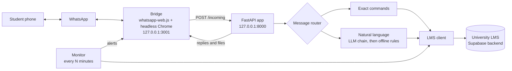

<div align="center">



<br>

[](https://www.python.org/)
[](https://nodejs.org/)
[](https://fastapi.tiangolo.com/)
[](https://wwebjs.dev/)
[](#-natural-language)
[](#-known-limits)

**Ask about attendance, deadlines, grades and lecture files in plain language.
TaleemGo AI answers on WhatsApp and sends alerts when something changes.**

[Features](#-features) |
[How it works](#-how-it-works) |
[Quick start](#-quick-start) |
[Commands](#-commands) |
[Configuration](#-configuration) |
[Privacy](#-privacy-and-security) |
[Deployment](#-deployment) |
[Testing](#-testing)

</div>

---

## ✨ Overview

University LMS sites make you log in, pick a course and click through menus to answer simple questions. TaleemGo AI moves those questions to WhatsApp. A student signs in once with their own LMS account, then asks things the way they would ask a classmate.

```text
Student   mera NLP ka attendance kitna hai
TaleemGo  NLP (DE304): 18/22 present, 81.8%, absent: 4

Student   download latest lecture from NLP
TaleemGo  [sends the newest lecture file]
          Latest in NLP (DE304): Week 7 - Lecture 7

Student   kal koi deadline hai?
TaleemGo  Upcoming deadlines, soonest first, with due dates
```

<sub>The conversation above is illustrative. Replies come from the student's own LMS data.</sub>

Each WhatsApp number gets its own private session. One student's data never reaches another student, and the bot sends alerts without being asked.

---

## 🧩 Features

| Area | What you get |
|---|---|
| Multi-user | Every WhatsApp number signs in with its own LMS email and password. The number of users is capped by `MAX_USERS` (default 5, including the admin's self-chat). |
| Natural language | English, Urdu script, Roman Urdu, Sindhi, Roman Sindhi and Hindi, including mixed messages. The model only picks an intent. It never writes a reply. |
| Commands | `courses`, `assignments`, `upcoming`, `grades`, `attendance`, `resources`, `clos` and `download`. They keep working when the AI is down. |
| Smart downloads | Ask for the latest lecture, a specific week, or a title. When a week has several files, the bot lists them and you reply with a number, several numbers, or `all`. Supported types: PDF, PPT, PPTX, DOC, DOCX and TXT, up to 100 MB. |
| Automatic alerts | New lecture, new assignment, new or updated grade, attendance marked present or absent, and deadline reminders 3 days and 1 day before. |
| Free AI with fallback | Gemini and Groq free tiers in an ordered chain. A rate-limited or retired model is skipped automatically. An offline keyword matcher answers when every provider fails. |
| Abuse protection | Off-topic chat gets no reply. Two off-topic messages within 10 minutes start a 2-hour commands-only lockout. Jailbreak attempts lock out immediately. |
| Admin tools | `users` lists registered accounts and their status. `llm` shows provider health. `llm test` runs a live check of every provider. |

---

## 🧭 How it works



Every incoming message passes through the same gates, in this order:

1. Activation: an unknown number is ignored until it sends an activation phrase such as `Hi TaleemGo AI`.
2. Sign-up: the email and password steps. These messages never reach a language model.
3. Pending choices: a reply to a numbered list, such as `2` or `all` after a file list.
4. Exact commands: `attendance NLP`, `courses`, and the rest.
5. Natural language: the model turns free text into a structured intent. Python resolves the course name and runs the same command code as step 4.
6. Offline rules: used when no provider can answer.

The bridge and the app talk over localhost with a shared token. The monitor runs on a schedule (`MONITOR_INTERVAL_MINUTES`, default 30), compares each student's LMS data with what it saw last time, and sends only what is new. The first run for a new student records a baseline and sends nothing.

---

## 🚀 Quick start

### Requirements

| Tool | Version |
|---|---|
| Python | 3.10 or newer (tested on 3.12) |
| Node.js | 18 or newer |
| Google Chrome | Installed locally, used headless by the bridge |
| A WhatsApp number | A dedicated one is best (see [Known limits](#-known-limits)) |
| An LMS account | Backed by Supabase, with the project URL and anon key |

### 1. Install

```bash
git clone https://github.com/alinawazcode/saathi.git
cd Saathi

pip install -r requirements.txt

cd whatsapp_bridge
npm install
cd ..
```

> [!TIP]
> `npm install` can stall while it downloads a bundled Chromium. Skip that download and point the bridge at your own Chrome with `CHROME_PATH`.
> PowerShell: `$env:PUPPETEER_SKIP_DOWNLOAD=1; npm install`
> Bash: `PUPPETEER_SKIP_DOWNLOAD=1 npm install`

`npm install` also applies a small patch to `whatsapp-web.js` that fixes media sending to `@lid` chats. The script is `whatsapp_bridge/patch-wwebjs.js` and it is safe to run more than once.

### 2. Configure

```bash
cp .env.example .env        # Windows: copy .env.example .env
```

Fill in at least these values:

| Variable | What to put |
|---|---|
| `SUPABASE_URL`, `SUPABASE_ANON_KEY`, `LMS_BASE_URL` | Your LMS backend and site |
| `BRIDGE_TOKEN` | A long random string, for example `python -c "import secrets; print(secrets.token_hex(32))"` |
| `CHROME_PATH` | Full path to Chrome. On Linux this is usually `/usr/bin/google-chrome-stable` |
| `ADMIN_NUMBER` | Your own number, digits only, to use the self-chat and the admin commands |
| `GEMINI_API_KEY`, `GROQ_API_KEY` | Free keys, see [Natural language](#-natural-language). Optional, the bot works without them |

The full list is in [Configuration](#-configuration).

### 3. Run

Open two terminals in the project folder.

```bash
# Terminal 1: the app
uvicorn app.wa_bot:api --port 8000
```

```bash
# Terminal 2: the WhatsApp bridge
cd whatsapp_bridge
npm start
```

> [!TIP]
> On Windows development environments, you can run `run-bridge.cmd` (inside `whatsapp_bridge/`) instead of `npm start`. It automatically restarts the bridge in a loop with a 5-second delay if Chrome crashes or exits.

Scan the QR code in terminal 2 with WhatsApp on the bot's phone: Settings, Linked devices, Link a device. Wait for `WhatsApp ready`. The session is saved in `whatsapp_bridge/.wwebjs_auth`, so you scan once.

### 4. Sign in as a student

1. Send `Hi TaleemGo AI` to the bot's number.
2. Send your LMS email.
3. Send your LMS password. It is used once to sign in and is not stored.
4. The bot replies `Connected as ...` and shows the command list.

---

## 💬 Commands

Typed commands always work, with or without the AI.

| Command | What it does |
|---|---|
| `courses` | Lists your enrolled courses |
| `assignments` | All assignments with status: submitted, pending, overdue |
| `upcoming` | Pending assignments with deadlines |
| `grades [course]` | Assignment marks as `8/10`, a running total, and teacher feedback |
| `attendance [course]` | Overall attendance, or one course. Courses under `ATTENDANCE_WARN` (default 75%) get a warning mark |
| `resources <course>` | Lecture files grouped by week |
| `clos <course>` | Course learning outcomes |
| `download <course> [week N or title]` | Sends a lecture file. Add `latest` for the newest one |
| `help` | Shows the command list |
| `login` | Signs in again after a session expires |
| `logout` | Disconnects and deletes everything stored for that number |

Admin only, from the `ADMIN_NUMBER` chat: `users`, `llm` and `llm test`.

---

## 🌍 Natural language

Students can skip the syntax. The same intent, in different languages:

| Language | Message | Result |
|---|---|---|
| English | `show my grade in NLP` | NLP grades |
| Roman Urdu | `HCI ke pehle hafte ki slides bhej do` | HCI week 1 files |
| Roman Urdu | `mera NLP ka attendance kitna hai` | NLP attendance |
| Urdu | `میرا NLP کا اٹینڈنس کتنا ہے؟` | NLP attendance |
| Sindhi | `منهنجي NLP جي حاضري ڪيتري آهي؟` | NLP attendance |
| Sindhi | `ڪو اسائنمينٽ ڏيڻو آهي؟` | Upcoming assignments |
| Mixed | `Ai ky latest lecture bhejo` | Newest AI lecture |

The bot answers in the language of the current message. A very short reply such as `2` or `ok` keeps the language of the previous message.

### Free AI providers

Providers are tried in the order of `LLM_PROVIDERS`. If one is rate limited or down, the next one answers immediately.

| Provider | Free key | Default models |
|---|---|---|
| Google Gemini | [Google AI Studio](https://aistudio.google.com/) | `gemini-3.5-flash-lite`, `gemini-3.8-flash`, `gemini-3.6-flash` |
| Groq | [Groq Console](https://console.groq.com/) | `openai/gpt-oss-20b`, `openai/gpt-oss-120b` |
| OpenRouter (optional) | [OpenRouter](https://openrouter.ai/) | set `OPENROUTER_MODELS` |
| Cerebras (optional) | [Cerebras Cloud](https://cloud.cerebras.ai/) | set `CEREBRAS_MODELS` |

Each message has a 12 second budget, with 6 seconds per request. When a model returns "not found", the bot moves to the next model in the list with no delay. When every provider fails, a student hits the hourly limit (`LLM_USER_LIMIT_PER_HOUR`, default 20), or `LLM_ENABLED=0`, the offline matcher in `app/llm/rules.py` handles the message.

> [!NOTE]
> Providers retire models often. If `llm` shows `bad model` for a provider, update `GEMINI_MODELS` or `GROQ_MODELS` in `.env`.
> Current lists: [Gemini deprecations](https://ai.google.dev/gemini-api/docs/deprecations) and [Groq models](https://console.groq.com/docs/models).

### What the bot will not do

TaleemGo AI is an LMS assistant, not a general chatbot.

- Requests about GPA, results, transcripts, timetables, fees and exams get a short "I can't do that yet" message that lists what is supported. They never count as strikes.
- Messages unrelated to university life get no reply.
- Two off-topic messages within 10 minutes (`LLM_STRIKES`, `LLM_STRIKE_WINDOW_MIN`) lock natural language for 2 hours (`LLM_LOCK_HOURS`). Typed commands still work during the lockout.
- A jailbreak attempt starts the lockout at once. The admin number is exempt.

---

## 🔐 Privacy and security

| Topic | How it is handled |
|---|---|
| Passwords | Used once to sign in. Never written to disk, never logged, never sent to a model provider. |
| Sign-up messages | Emails and passwords skip the AI entirely. |
| Model prompts | Contain the student's message text and a fixed instruction. They contain no course names, file titles, grades, attendance or chat ids. The model returns an intent and a raw course phrase. Python finds the course. |
| Model output | Never sent to students. Only a whitelist of intents can run, so the model cannot trigger `logout`, `login`, `users` or `llm`. |
| Session tokens | Encrypted with Fernet (`data/users/<hash>/tokens.enc`). The key is `TALEEMGO_SECRET_KEY`. |
| Isolation | Each number has its own folder, named from a hash of its chat id, and its own monitor state. |
| Stored per user | Email, status and timestamps in `data/users.db`, plus the encrypted tokens and the list of items already announced. |
| Deletion | `logout` removes all of it. |
| Local network | The bridge listens on `127.0.0.1` only and requires `BRIDGE_TOKEN`. |
| Secrets in git | `.env`, `data/` and `.wwebjs_auth/` are git-ignored. Keep them out of commits and screenshots. |

Free tiers of AI providers can keep request logs under their own terms. The welcome message tells students to send their password only when the bot asks for it at login.

---

## 📦 Deployment

| Option | When to use it |
|---|---|
| Your own computer | Demos and short pilots. Keep it plugged in, stop it from sleeping, and keep both terminals open. |
| Azure Ubuntu VM | Always-on use. [`deploy/DEPLOY.md`](deploy/DEPLOY.md) covers the setup script, systemd services, firewall, QR scan over SSH, daily backups and cleanup. |

The deploy folder contains:

| File | Purpose |
|---|---|
| `setup.sh` | One-time server setup |
| `update.sh` | Pull new code and restart the services |
| `status.sh` | Service state, memory, bridge health, recent AI log lines |
| `backup.sh` and a systemd timer | Daily archive of `.env`, `data/` and the WhatsApp session, keeping 7 |
| `taleemgo-api.service`, `taleemgo-bridge.service` | systemd units that restart on failure |

> [!IMPORTANT]
> One WhatsApp session can run in one place at a time. Stop the bot on your computer before you scan the QR code on a server, and scan a fresh code there. Do not copy `.wwebjs_auth` between machines.

To change the bot's WhatsApp number, stop the bridge, delete `whatsapp_bridge/.wwebjs_auth`, update `ADMIN_NUMBER` in `.env`, remove any `ADMIN_LID` line, start the bridge and scan with the new phone. Students keep their accounts and message the new number.

---

## 🔧 Configuration

<details>
<summary>Every setting in <code>.env</code></summary>

<br>

| Variable | Default | Meaning |
|---|---|---|
| `SUPABASE_URL` | none | LMS backend URL |
| `SUPABASE_ANON_KEY` | none | Public anon key of that backend |
| `LMS_BASE_URL` | none | LMS website, used for file downloads |
| `BRIDGE_TOKEN` | none | Shared secret between the bridge and the app |
| `BRIDGE_PORT` | `3001` | Bridge port on localhost |
| `BRIDGE_URL` | `http://127.0.0.1:3001` | Where the app finds the bridge |
| `PY_WEBHOOK` | `http://127.0.0.1:8000/incoming` | Where the bridge sends messages |
| `CHROME_PATH` | Windows Chrome path | Chrome used by the bridge |
| `MONITOR_INTERVAL_MINUTES` | `30` | How often alerts are checked |
| `MAX_USERS` | `5` | Maximum registered numbers, admin included |
| `ACTIVATION_PHRASES` | `taleemgo ai,taleem go ai,taleemgo` | Phrases that wake the bot for a new number |
| `ATTENDANCE_WARN` | `75` | Attendance percentage that gets a warning mark |
| `TALEEMGO_SECRET_KEY` | generated | Encryption key. Created on first run if missing. Back it up. |
| `ADMIN_NUMBER` | empty | Your number, digits only. Enables self-chat and admin commands |
| `ADMIN_LID` | empty | Your WhatsApp `@lid` id, only if self-chat does not reply |
| `DEBUG_SELF` | `0` | Set to `1` to print self-chat diagnostics |
| `LLM_ENABLED` | `1` | Set to `0` to run on commands and offline rules only |
| `LLM_PROVIDERS` | `gemini,groq` | Order of the provider chain |
| `GEMINI_API_KEY`, `GROQ_API_KEY` | empty | Free keys. Optional: `OPENROUTER_API_KEY`, `CEREBRAS_API_KEY` |
| `GEMINI_MODELS`, `GROQ_MODELS` | see above | Ordered model lists, comma separated |
| `LLM_USER_LIMIT_PER_HOUR` | `20` | AI calls per student per hour |
| `LLM_STRIKES` | `2` | Off-topic messages before a lockout |
| `LLM_STRIKE_WINDOW_MIN` | `10` | Window for counting strikes |
| `LLM_LOCK_HOURS` | `2` | Lockout length |
| `LLM_NOTIFY_ON_LOCK` | `1` | Tell the student when a lockout starts |
| `LLM_ADMIN_EXEMPT` | `1` | Exempt the admin from lockouts |
| `LLM_HELP_REPLY_INTERVAL_MIN` | `2` | Minimum gap between "I didn't understand" replies |
| `GREETING_REPLY` | `1` | Reply to greetings |

`SATHI_SECRET_KEY` from older versions is still read. Rename it to `TALEEMGO_SECRET_KEY` and keep the same value, because a new key makes saved sessions unreadable and every student would have to sign in again.

</details>

---

## 🧪 Testing

The unit tests run offline with fake providers and a fake LMS. Run them from the project folder:

```bash
python -m unittest app/test_branding.py app/test_multiuser.py app/test_grades.py app/test_llm.py app/test_professional.py
```

| File | Covers |
|---|---|
| `test_multiuser.py` | Sign-up, isolation, user cap, self-chat detection, downloads |
| `test_llm.py` | Provider failover, JSON validation, privacy of prompts, lockouts, languages |
| `test_grades.py` | Grade maths, grade alerts, a guard that keeps sensitive LMS columns out of the code |
| `test_professional.py` | Conversation flow: latest lecture, follow-ups, language, empty-reply guards |
| `test_branding.py` | No leftover product names |

The multi-user suite includes a bridge test, so run `npm install` in `whatsapp_bridge` first. `app/test_all.py` is a manual smoke test against a real LMS account and is not part of the unit suite.

---

## 📁 Project layout

```text
app/
  wa_bot.py          FastAPI app, message router, command handlers
  users.py           SQLite users, per-user folders, locks, pending choices
  lms_client.py      LMS access: login, refresh, data, downloads
  courses.py         Course matching and query cleanup
  wa_monitor.py      Scheduled change detection and alerts
  wa_transport.py    Sending messages and files through the bridge
  state.py           What each student has already been told
  timeutils.py       UTC to local time
  llm/
    providers.py     Provider calls, cooldowns, model failover
    router.py        Provider chain and time budget
    intent.py        Prompt, JSON schema, validation
    rules.py         Offline matcher and language detection
    i18n.py          Fixed replies in English, Urdu and Sindhi, with cache
    lang_data.py     Keywords and example phrases
  bot.py, monitor.py Earlier single-user Telegram version, kept for reference
whatsapp_bridge/     whatsapp-web.js bridge (Express on localhost)
deploy/              Azure VM scripts and guide
scripts/             Developer scripts used while mapping the LMS
data/                Runtime data, git-ignored
```

---

## 🩺 Troubleshooting

<details>
<summary>Common problems</summary>

<br>

| Symptom | Cause and fix |
|---|---|
| Bridge stops after `Bridge on ...` and never says `WhatsApp ready` | A leftover Chrome from a previous run is holding the saved session. The bridge now cleans it up on start. Close the window, run `npm start` again, and read the `[LOADING]` lines if it repeats. |
| `Data passed to getter must include an id property` when sending files | The media patch is missing. Run `npm install` in `whatsapp_bridge` again. |
| `Attempted to use detached Frame` | The bridge's browser page died, usually after the computer slept. Restart the bridge. The saved login stays. |
| The self-chat does not reply | Set `ADMIN_NUMBER`. If it still fails, set `DEBUG_SELF=1`, send yourself a message, and copy the printed `to=` value into `ADMIN_LID`. |
| `llm` shows `bad model` | The provider retired a model. Update `GEMINI_MODELS` or `GROQ_MODELS`. |
| `llm` shows `bad key` | The API key is wrong, revoked or a placeholder. Replace it or leave it empty. |
| Alerts stop while the computer is asleep | The monitor only runs while the app runs. Disable sleep or move to a server. |

</details>

---

## 🚧 Known limits

- WhatsApp has no free official bot API for this use. TaleemGo AI automates WhatsApp Web through `whatsapp-web.js`, which WhatsApp does not endorse. Accounts that automate WhatsApp can be restricted, so use a dedicated number and not your personal one.
- It reads assignment marks. It does not calculate GPA, weighted course grades, or letter grades, and it does not read transcripts, fees, timetables or exam schedules.
- It cannot submit assignments.
- It runs one headless Chrome and one SQLite file, which is why the default cap is 5 students.
- Free AI tiers have rate limits. The offline matcher covers the gaps with simpler understanding.

---

## 📄 Disclaimer

TaleemGo AI is an independent student project. It is not affiliated with, endorsed by, or sponsored by WhatsApp, Meta or any university. Each student signs in with their own LMS credentials and sees only their own data. Check that your institution allows this kind of access before you share the bot with others.

---

<div align="center">

Built by [Ali Nawaz](https://github.com/alinawazcode)

</div>
